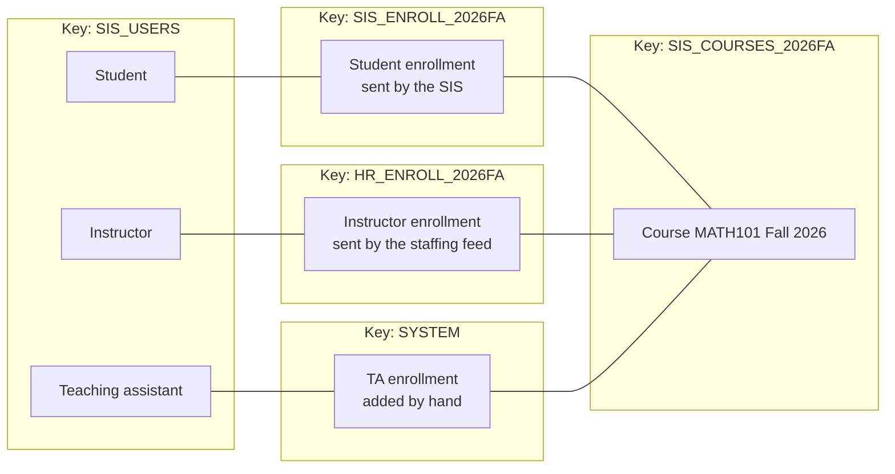

# Data Source Key strategy primer

This primer is for institutions planning or reviewing a Blackboard Learn SIS integration. It explains
what a Data Source Key does and how to choose a set of keys that keeps your integration safe to run
and easy to manage over many terms. It covers strategy, not file formats: for the `data_source_key`
column and the endpoints that use it, see the [Snapshot Flat File overview](../snapshot/snapshot-flat-file-overview.md#data-source-keys)
and the [object specs](../snapshot/specs/).

## Contents

1. [Objectives](#objectives): what you should be able to decide after reading.
2. [How Data Source Keys work](#how-data-source-keys-work): the three ideas everything else builds on.
3. [Key strategy options](#key-strategy-options): common patterns and their trade-offs.
4. [Recommended starting pattern](#recommended-starting-pattern): a default set of keys you can adapt.
5. [Naming conventions](#naming-conventions): rules for key names.
6. [Move records to a different key](#move-records-to-a-different-key): change the key on records that already exist.
7. [How keys limit a refresh](#how-keys-limit-a-refresh): why your key plan decides what a refresh can reach.
8. [Common mistakes](#common-mistakes): symptoms, causes and fixes.
9. [Example plan](#example-plan): a worked set of keys for one institution.
10. [Terms](#terms): definitions used in this primer.

## Objectives

After reading this primer you should be able to:

- Explain to your team what a Data Source Key is and why it matters.
- Choose how many keys you need and what each one covers.
- Name keys consistently.
- Avoid the mistakes that cause a refresh to disable records it shouldn't.

## How Data Source Keys work

**A Data Source Key is a label on every record an integration manages.** Each user, course,
organization, enrollment, term, hierarchy node and association in Learn carries exactly one key. The
key was originally meant to record where a record came from (which system or feed). In practice it
can stand for whatever grouping is useful to manage records by, such as a term, a campus or a
program. It can even mark a record's status: some institutions create a key such as
`PENDING_PURGE` and move courses they plan to delete onto it, so those courses are easy to find and
review before they are removed. Whatever it represents, it groups records so they can be managed together. A
key must exist in Learn before a feed can use it. An administrator can create one in
**Administrator Panel > Data Integration > Data Source Keys**, or the SIS Integration Framework can
create one while you set up or manage an integration.

**Each record has its own key, separate from related records.** An enrollment has its own key, which
does not have to match the key of its course or its user. For example, one course created by the
SIS can hold student enrollments sent by the SIS, instructor enrollments sent by a separate staffing
feed, and a teaching assistant an administrator added by hand. Each group of enrollments carries its
own key, so each can be refreshed or cleaned up without touching the others.

The diagram shows that course. Each box is a key, and the records inside it carry that key. The
lines show which user and course each enrollment connects.

Anything aimed at `SIS_ENROLL_2026FA` reaches only the student enrollment, because the instructor
and TA enrollments, the course and the users all sit under other keys. [How keys limit a refresh](#how-keys-limit-a-refresh)
explains why that matters.

**Records created by hand get the `SYSTEM` key.** Courses, users and enrollments that someone creates
in the Learn interface are labeled `SYSTEM`, not with an SIS key. Because of that, a refresh scoped to
an SIS key leaves manually created records alone. Keeping SIS records off the `SYSTEM` key protects
both sides.

## Key strategy options

Most institutions use one of four patterns, or a mix. The trade-off is always the same: more keys
give you finer control over what a refresh or a cleanup touches, at the cost of more keys to keep
track of.

| Pattern | Example keys | Works well when | Watch out for |
|---|---|---|---|
| **One key for everything** | `SIS` | Small pilots, or feeds that only ever use Store | Any refresh by data source covers every SIS record of that object type. You can't separate one term from another |
| **One key per object type** | `SIS_USERS`, `SIS_COURSES`, `SIS_ENROLLMENTS` | You want to tell at a glance what an integration manages | Past and current terms still share one key, so a refresh needs every term in the file |
| **Per object type and term** | `SIS_COURSES_2026FA`, `SIS_ENROLL_2026FA` | Courses and enrollments are planned term by term | More keys to create each term. Create them as part of term setup |
| **Per source system** | `SIS_BANNER`, `CE_SYSTEM`, `HR_FEED` | Several systems feed Learn (for example credit, continuing education and staff) | Two systems must never manage the same record. Pick one owner for each record |

## Recommended starting pattern

For most institutions, a good default is to use permanent keys for records that persist across terms
and term keys for records that belong to one term.

| Object | Key scope | Why |
|---|---|---|
| Users | One permanent key per source system | People persist across terms. A term key would leave a user labeled with whichever term last touched them |
| Terms | One permanent key | The term list grows over time, and every term should stay under the same key |
| Courses | One key per term | Each term's courses can be refreshed, reported on or cleaned up as a group without affecting other terms |
| Enrollments | One key per term, matching the course's term | A term's enrollment refresh can't reach enrollments in other terms |
| Organizations and their memberships | One permanent key | Organizations usually outlast terms |
| Hierarchy nodes and associations | One permanent key | The institutional hierarchy changes rarely and is managed as a whole |
| Records created by hand | `SYSTEM` (automatic) | Keeps manual work out of reach of SIS refreshes |

Treat this as a starting point. If your institution runs overlapping parts of term, or several
campuses with separate calendars, a key per term and campus may suit you better.

## Naming conventions

Key names are read by administrators, help desk staff and anyone reporting on your data, often years
after they were created. On the **Users** and **Courses** pages of the Administrator Panel, you can
search by Data Source Key and sort the list by its column. A course's **Enrollments** page shows
each enrollment's key, but you can't search by it there. A well-chosen name lets an administrator
find and group records at a glance.
These rules keep names readable:

- **Use one pattern everywhere:** source, then object, then scope. For example `SIS_ENROLL_2026FA`.
- **Use capital letters, digits and underscores only.** Avoid spaces and other punctuation so keys are
  safe in files, scripts and queries.
- **Use the same term code your SIS uses,** so a key can be matched to a term without a lookup table.
- **Never reuse a key name for a different purpose.** Retire it and create a new one instead.
- **Fill in the key's description** in Learn with what it covers and which feed uses it. This
  includes keys the integration framework created for you. Check that their names follow your
  pattern before the first production load.
- **Keep a list of keys** (name, object, scope, owning feed, date created) alongside your integration
  documentation.

A note on older keys: years ago, Snapshot integrations created and used keys whose names matched the
names of the feed files, for example `spring2004_enrollments.txt`. That is generally no longer the
case. If your Learn instance has keys that look like file names, they most likely date from that era. Records may still carry them, so check
what each one holds before you retire it or build a new strategy around it.

## Move records to a different key

You may need to move records when you adopt a new strategy, merge feeds, or take over records that
were created by hand. In a Snapshot Flat File feed, the `new_data_source_key` column moves a record
from its current key to the one you name.

1. Create the target key, either in **Administrator Panel > Data Integration > Data Source Keys** or
   through the integration's settings.
2. Build a Store file that contains the records to move, with the target key in the
   `new_data_source_key` column. See the object's spec in [`snapshot/specs/`](../snapshot/specs/)
   for the column.
3. Post the file to a test or staging environment first and confirm the records now show the new key.
4. Post the file to production with the Store operation, not a refresh.
5. Update your regular feeds to send the new key, so the next load doesn't move the records back.

## How keys limit a refresh

**The key sets the reach of a Complete Refresh by Data Source.** A *Complete Refresh by Data Source*
(the `refreshlegacy` endpoint) treats the submitted file as the full list of records that should
exist under one key. Anything under that key that is missing from the file is disabled or purged,
depending on the object type. Records under other keys are not touched. So the way you divide
records into keys decides what a refresh can and cannot affect.

A plain *Complete Refresh* (the `refresh` endpoint) is scoped differently: to the integration
instance that created the records, not to a key. The two are not interchangeable. See
[REFRESH Risk](../snapshot/operations/snapshot-posting-guide.md#refresh-risk) before using either on
a recurring feed.

## Common mistakes

| Symptom | Likely cause | Fix |
|---|---|---|
| A refresh disabled courses or enrollments from other terms | Several terms share one key, and the file only contained the current term | Split courses and enrollments into term keys. Until then, use Store instead of refresh |
| A refresh removed enrollments that instructors added by hand | The manual enrollments carried the SIS key, not `SYSTEM` | Keep manual work on `SYSTEM`. Check whether any process assigns the SIS key to manual records |
| Users moved between keys every term | Users were sent with a term key | Give users one permanent key and leave terms to courses and enrollments |
| A feed is rejected because of the key | The key in the file or the integration configuration doesn't exist in Learn, or is spelled differently | Create the key, or correct the name. See the [pre-flight checklist](../snapshot/operations/snapshot-posting-guide.md#pre-flight-checklist) |
| Nobody can say what a key is for | The key has no description and no list records it | Add descriptions in Learn and keep a key list with your integration documentation |

## Example plan

An institution feeds Learn from one SIS for credit courses and from a continuing education (CE)
system for non-credit courses. Fall 2026 is term `2026FA`.

| Key | Object | Scope | Fed by |
|---|---|---|---|
| `SIS_USERS` | Users | Permanent | SIS |
| `CE_USERS` | Users | Permanent | CE system |
| `SIS_TERMS` | Terms | Permanent | SIS |
| `SIS_COURSES_2026FA` | Courses | Fall 2026 | SIS |
| `SIS_ENROLL_2026FA` | Enrollments | Fall 2026 | SIS |
| `CE_COURSES` | Courses | Permanent (CE runs continuously) | CE system |
| `CE_ENROLL` | Enrollments | Permanent | CE system |
| `SIS_ORGS` | Organizations and memberships | Permanent | SIS |
| `SIS_HIERARCHY` | Hierarchy nodes and associations | Permanent | SIS |

With this plan:

- A Fall 2026 enrollment refresh reaches only `SIS_ENROLL_2026FA`. Spring enrollments, CE
  enrollments and manual enrollments are untouched.
- Each CE user belongs to one system. A person who is in both systems gets one account, owned by
  the SIS, and the CE feed enrolls that account rather than sending its own copy.
- Before spring, the team creates `SIS_COURSES_2027SP` and `SIS_ENROLL_2027SP` as part of term setup.

## Terms

| Term | Meaning |
|---|---|
| Data Source Key | A label on each integration-managed record that groups records for management. Column `data_source_key` in Snapshot Flat Files |
| Complete Refresh by Data Source | The `refreshlegacy` operation. Treats the file as the full set of records under one key and disables or purges the rest |
| Complete Refresh | The `refresh` operation. Scoped to the integration instance that created the records, not to a key |
| Store | The `store` operation. Inserts or updates the records in the file and leaves everything else alone |
| `SYSTEM` | The key Learn gives records created by hand in the interface |
| Term key | A key that covers one academic term's records, for example `SIS_COURSES_2026FA` |
| Permanent key | A key that covers records which persist across terms, for example `SIS_USERS` |

## Related

- [Snapshot Flat File overview](../snapshot/snapshot-flat-file-overview.md): operation types and delete behaviors.
- [Snapshot posting guide](../snapshot/operations/snapshot-posting-guide.md): the pre-flight checklist and REFRESH Risk.
- [Snapshot diff guide](../snapshot/operations/snapshot-diff-guide.md): how refresh scope affects a diff-based feed.

---

This content is provided as-is, without warranty or support of any kind. Blackboard retains all
rights. Use at your own risk.
